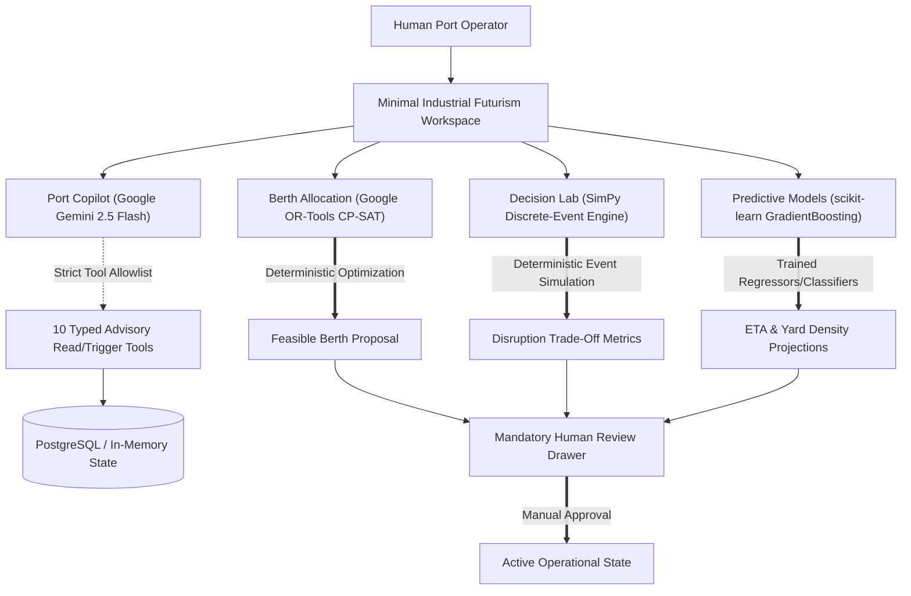

# PORTOS AI — Operational Limitations & Governance Disclosure

**Repository:** `portos-ai`  
**Applicability:** Blue AI Challenge 2026–27 Showcase & Evaluation  
**Document Revision:** 1.0.0 (Milestone 16 Audit)  
**Date:** 2026-11-03

---

## 1. Absolute Operational Truthfulness & Boundary Directives

> [!CAUTION]
> **No Live CPA, Customs, or TOS Integration:**  
> PORTOS AI is an illustrative research and competition decision-support prototype. At no point in its execution does the system connect to Chattogram Port Authority (CPA) computer systems, National Board of Revenue (NBR) ASYCUDA customs networks, live Terminal Operating Systems (TOS), commercial marine AIS feeds, or physical quay crane programmable logic controllers (PLCs). Any portrayal of live operations is strictly an interactive simulation for evaluation purposes.

> [!WARNING]
> **Advisory Role Only — No Real-World Control:**  
> PORTOS AI does not possess, nor does it seek, automated authority to:
> 1. Issue navigational clearances, pilot boarding approvals, or channel entrance permissions.
> 2. Order vessel course changes, speed alterations, or anchorage movements.
> 3. Control or dispatch physical container handling equipment (quayside ship-to-shore cranes, RTGs, reach stackers, or internal transfer vehicles).
> 
> All schedules, berth allocations, equipment assignments, and congestion forecasts generated by PORTOS AI are **advisory proposals** requiring explicit, certified human port authority review and approval.

---

## 2. Five-Tier Data Provenance Taxonomy

To prevent ambiguity between observed historical records, numerical models, and synthetic scenarios, all data objects in PORTOS AI are explicitly tagged with one of five standardized statuses:

| Status Tag | Operational Meaning | System Handling & UI Rendering |
| :--- | :--- | :--- |
| `SIMULATED` | Parametric or discrete-event data generated by SimPy, synthetic random generators, or incident injection. | Neutral Slate badge (`bg-slate-100`). Clear simulation notice displayed. |
| `OBSERVED` | Real or historical data ingested through the Port Data Bridge (`/data-centre`) with verified cryptographic SHA-256 hash. | Emerald/Teal badge (`bg-teal-50`). Origin document metadata inspectable. |
| `FORECAST` | Projected forward estimates generated by scikit-learn GradientBoosting pipelines (ETA delays, yard density). | Sky Blue badge (`bg-sky-50`). Accompanied by model version, horizon, and confidence metrics. |
| `DERIVED` | Calculated via deterministic physical equations or formulas (e.g., GLEC CO2e emissions, quay meter draft compatibility). | Amber badge (`bg-amber-50`). Underlying mathematical equations and conversion factors inspectable. |
| `UNAVAILABLE` | Telemetry or input data missing or not configured. | Dashed Rose badge (`bg-rose-50`). No silent guessing or hallucinated fallbacks permitted. |

---

## 3. Separation of Analytical Roles

PORTOS AI strictly separates analytical roles to prevent generative hallucination in numerical and scheduling domains:

### Strict Guardrails:
1. **Google Gemini (LLM):** Restricted strictly to natural-language briefing, synthesis of tool execution outputs, and explaining schedule conflicts. The LLM **never** invents schedule allocations, arrival delays, or equipment productivity metrics.
2. **Google OR-Tools CP-SAT:** Deterministically solves constrained combinatorial berth allocations respecting vessel draft, berth length, tidal windows, crane outreach, and safety buffer times.
3. **SimPy Engine:** Models queuing dynamics, tidal lock delays, and crane productivity deterministically using discrete-event scheduling.
4. **scikit-learn Pipelines:** Computes regression delays and classification tiers from defined numerical feature vectors.

---

## 4. Synthetic Data Limitations & Environmental Approximations

1. **River Fairway Dynamics:** Karnaphuli river approach dynamics feature high siltation, rapid seasonal sandbar formation, and semi-diurnal tides with high-water variations reaching up to 4.5 meters. The prototype models tidal windows parametrically using cosine approximations and draft threshold step functions rather than 3D hydrodynamic bathymetry modeling.
2. **Inland Container Depots (ICDs):** In the Chittagong port ecosystem, 19+ off-dock inland container depots handle empty boxes and private export aggregation. The current prototype models quayside and main terminal container blocks, abstracting off-dock transfers into scheduled dwell outflow rates.
3. **Meteorological Shocks:** Monsoon surges and tropical cyclonic depressions are simulated via discrete scenario presets (`monsoon_surge_delay`, `crane_outage`, `yard_congestion`). Extreme real-world cyclone conditions (e.g., Signal 10 port closure) require human emergency management outside the scope of this software.
4. **Green Port Emissions:** CO2e, SOx, and NOx estimates use standardized GLEC Framework and IMO 4th GHG Study emission factors based on vessel hoteling time and crane electric consumption. Secondary emissions from internal yard diesel tractors, idling road trucks, and drayage tugboats are explicitly scoped out and labeled as unmeasured.

---

## 5. Human-in-the-Loop Governance

No schedule proposal generated by Google OR-Tools or recovery plan modeled by SimPy is automatically applied to terminal operational state. Every recommendation must be:
1. Inspected in the **Assignment Review Drawer** (`/berth-planner`) or **Decision Lab** (`/scenario-lab`).
2. Compared against the active baseline schedule.
3. Explicitly confirmed by a human operator through the **Propose & Review** modal, logging the reviewing operator ID, timestamp, and justification.

