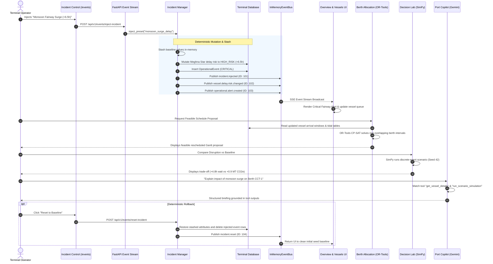
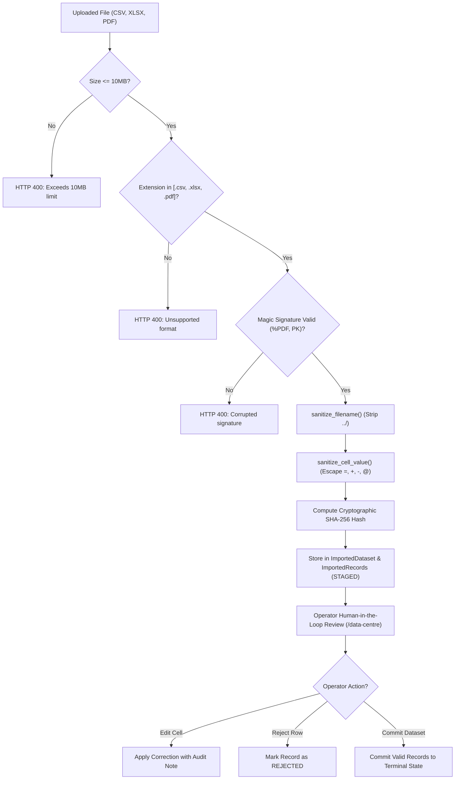

# PORTOS AI — System Architecture & Data Flow

**Document ID:** `ARCH-FLOW-001`  
**Revision:** 1.0.0 (Milestone 17 Package)  
**Date:** 2026-11-03

---

## 1. High-Level Component Architecture

```mermaid
graph TB
    subgraph Frontend ["Frontend Tier (Next.js 14 App Router)"]
        UI["Minimal Industrial Futurism Workspace"]
        Twin["Digital Twin (Three.js / 2D Canvas)"]
        Gantt["Berth Gantt & Proposal Modal"]
        LabUI["Decision Lab & Trade-Off Cards"]
        CopilotUI["Port Intelligence Copilot Chat"]
        StreamCtx["EventStreamContext (SSE Client)"]
    end

    subgraph Backend ["Backend Tier (FastAPI Service Layer)"]
        Router["API v1 Router (/api/v1/...)"]
        Bus["InMemoryEventBus (SSE Monotonic IDs)"]
        IncMgr["IncidentManager (Rollback Stashing)"]
        CopilotAgent["PortCopilotAgent (Tool Allowlist)"]
    end

    subgraph AnalyticalEngines ["Deterministic Analytical & ML Tier"]
        ORTools["Google OR-Tools CP-SAT (Berth Scheduler)"]
        SimPyEngine["SimPy Engine (Discrete-Event Simulator)"]
        SKLearnETA["scikit-learn ETA Regressor & Classifier"]
        SKLearnYard["scikit-learn Yard Forecaster"]
        GreenCalc["Green Port GLEC Calculator"]
        Parser["Document Parser & Formula Neutralizer"]
    end

    subgraph Storage ["Persistence Tier"]
        DB[("PostgreSQL 16 + PostGIS / SQLite Fallback")]
        Artifacts[("Committed ML Models (.joblib)")]
    end

    UI --> Router
    Twin --> Router
    Gantt --> Router
    LabUI --> Router
    CopilotUI --> Router
    StreamCtx <==|"Server-Sent Events (/api/v1/events/stream)"| Bus

    Router --> Bus
    Router --> IncMgr
    Router --> CopilotAgent

    IncMgr --> Bus
    IncMgr --> DB

    Router --> ORTools
    Router --> SimPyEngine
    Router --> SKLearnETA
    Router --> SKLearnYard
    Router --> GreenCalc
    Router --> Parser

    CopilotAgent -.->|"Strict Tool Allowlist"| Router
    SKLearnETA <--> Artifacts
    Parser --> DB
    Router --> DB
```

---

## 2. Cross-Module Incident & Workflow Synchronization Data Flow

This diagram illustrates what happens when an operator or automated scenario triggers an operational disruption (e.g., Monsoon Surge):



---

## 3. Document Ingestion & Provenance Data Flow



