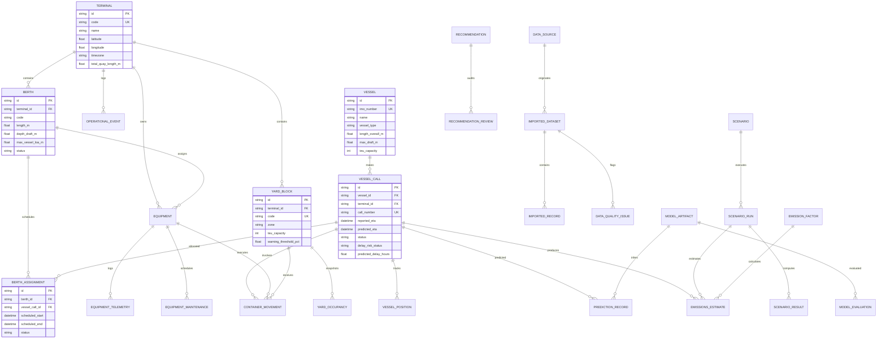

# PORTOS AI — Database Schema & Data Dictionary

**Document ID:** `ARCH-DB-001`  
**Version:** 1.0  
**Effective Date:** November 2026  
**ORM / Migration Engine:** SQLAlchemy 2 / Alembic  
**Target Engine:** PostgreSQL 16 + PostGIS (with local SQLite compatibility)

---

## 1. Entity-Relationship (ER) Diagram

---

## 2. Core Domain Entities & Data Dictionary

### 2.1 Quayside & Terminal Infrastructure
- **`terminals`**: Terminal authority representation (`id`, `code`, `name`, `latitude`, `longitude`, `timezone`, `total_quay_length_m`).
- **`berths`**: Quayside berth slots (`id`, `terminal_id`, `code`, `length_m`, `depth_draft_m`, `max_vessel_loa_m`, `status` (`AVAILABLE`, `OCCUPIED`, `MAINTENANCE`, `RESERVED`)).
- **`berth_assignments`**: Discrete time windows allocating a berth to a vessel call (`id`, `berth_id`, `vessel_call_id`, `scheduled_start`, `scheduled_end`, `status` (`PROPOSED`, `CONFIRMED`, `ACTIVE`, `COMPLETED`, `CANCELLED`)).

### 2.2 Vessel Traffic & Tracking
- **`vessels`**: Vessel specifications (`id`, `imo_number`, `name`, `call_sign`, `flag_country`, `vessel_type`, `length_overall_m`, `beam_m`, `max_draft_m`, `teu_capacity`, `dwt_tonnes`).
- **`vessel_calls`**: Port voyage calls (`id`, `vessel_id`, `terminal_id`, `call_number`, `voyage_number`, `reported_eta`, `predicted_eta`, `status` (`EN_ROUTE`, `OUTER_ANCHORAGE`, `PILOT_BOARDING`, `BERTHED`, `OPERATING`, `COMPLETED`, `CANCELLED`), `delay_risk_status` (`NORMAL`, `WATCH`, `HIGH_RISK`), `predicted_delay_hours`).
- **`vessel_positions`**: Time-stamped tracking breadcrumbs (`id`, `vessel_call_id`, `timestamp`, `latitude`, `longitude`, `speed_knots`, `heading_degrees`, `navigational_status`, `distance_to_pilot_nm`).

### 2.3 Equipment & Telemetry
- **`equipment`**: Cranes and mobile haulage units (`id`, `terminal_id`, `code`, `equipment_type` (`STS_CRANE`, `RTG_CRANE`, `STRADDLE_CARRIER`, `INTERNAL_TRUCK`), `status` (`OPERATIONAL`, `DEGRADED`, `MAINTENANCE`, `OFFLINE`), `rated_capacity_tonnes`, `rated_moves_per_hour`).
- **`equipment_telemetry`**: Operational performance logs (`id`, `equipment_id`, `timestamp`, `moves_per_hour_actual`, `power_consumption_kwh`, `trolley_position_m`).
- **`equipment_maintenance_events`**: Disruption windows and outages (`id`, `equipment_id`, `maintenance_type`, `started_at`, `expected_end_at`, `is_simulated_disruption`).

### 2.4 Container Yard Management
- **`yard_blocks`**: Sector definitions (`id`, `terminal_id`, `code`, `zone` (`IMPORT`, `EXPORT`, `REEFER`, `EMPTY`), `teu_capacity`, `warning_threshold_pct`).
- **`yard_occupancy_observations`**: Historical and multi-horizon density snapshots (`id`, `yard_block_id`, `timestamp`, `occupied_teu`, `occupancy_pct`, `risk_tier` (`NORMAL`, `WATCH`, `HIGH_RISK`), `forecast_horizon_hrs`).
- **`container_movement_events`**: Anonymized aggregated container transfer tallies without consignee PII (`id`, `yard_block_id`, `vessel_call_id`, `timestamp`, `movement_type`, `teu_count`).

### 2.5 Simulation & Scenario Lab
- **`operational_events`**: Disruption alerts and timeline items (`id`, `terminal_id`, `timestamp`, `event_type`, `severity`, `title`, `description`, `payload_json`).
- **`scenarios`**: SimPy configuration specifications (`id`, `code`, `name`, `is_baseline`, `parameters_json`).
- **`scenario_runs`**: Execution runs (`id`, `scenario_id`, `run_timestamp`, `random_seed`, `duration_hours`, `status`).
- **`scenario_results`**: Computed outputs (`id`, `scenario_run_id`, `metric_name`, `metric_value`, `unit`, `comparison_delta_baseline`).

### 2.6 Data Bridge & Provenance Tracking
- **`data_sources`**: External and synthetic data origin registry (`id`, `code`, `name`, `source_type`, `url`, `is_verified`).
- **`imported_datasets`**: Batches and document files (`id`, `data_source_id`, `file_name`, `file_format`, `file_sha256`, `record_count`, `ingestion_status`).
- **`imported_records`**: Extracted rows (`id`, `imported_dataset_id`, `row_index`, `raw_payload_json`, `normalized_payload_json`, `validation_status`).
- **`data_quality_issues`**: Audit findings (`id`, `imported_dataset_id`, `field_name`, `issue_type`, `description`, `severity`).

### 2.7 Machine Learning Models
- **`model_artifacts`**: Serialized model metadata (`id`, `model_name`, `model_version`, `task_type`, `algorithm`, `artifact_path`, `hyperparameters_json`).
- **`model_evaluations`**: Offline benchmark results (`id`, `model_artifact_id`, `mae_hours`, `rmse_hours`, `r2_score`, `precision`, `recall`, `f1_score`, `synthetic_caveat`).
- **`prediction_records`**: Output inferences (`id`, `model_artifact_id`, `vessel_call_id`, `prediction_timestamp`, `input_features_json`, `predicted_value_float`, `predicted_label_str`).

### 2.8 Sustainability & Recommendations
- **`emission_factors`**: Activity-to-emissions multiplier table (`id`, `pollutant`, `activity_type`, `factor_value`, `factor_unit`, `source_reference`, `is_illustrative_assumption`).
- **`emissions_estimates`**: Computed footprint entries (`id`, `vessel_call_id`, `scenario_run_id`, `emission_factor_id`, `estimated_emissions_kg`).
- **`recommendations`**: Advisory solver recommendations (`id`, `recommendation_type`, `title`, `description`, `proposed_payload_json`, `status`).
- **`recommendation_reviews`**: Human-in-the-loop review audit trail (`id`, `recommendation_id`, `reviewed_at`, `reviewer_role`, `decision`, `review_notes`).

---

## 3. Mandatory Provenance Mixin Columns
Every operational entity inherits the standard audit fields:
- `data_status`: `SIMULATED | OBSERVED | FORECAST | DERIVED | UNAVAILABLE`
- `source_name`: String identifier of generator or feed
- `source_url`: Optional canonical link
- `source_document_id`: Optional document reference
- `observed_at`: UTC timestamp of source observation
- `ingested_at`: UTC timestamp of database ingestion
- `methodology_note`: Description of calculation or simulation derivation
- `created_at` / `updated_at`: UTC audit timestamps

