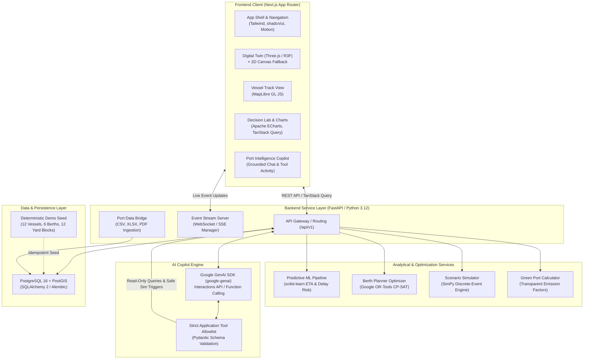
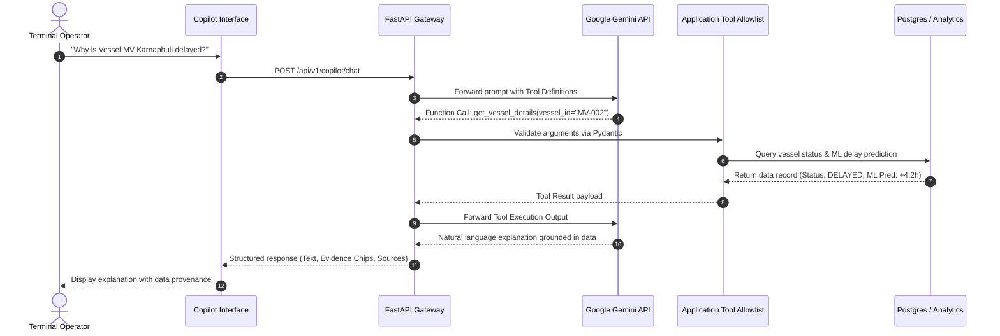

# PORTOS AI — System Architecture & Component Overview

**Document ID:** `ARCH-SYS-001`  
**Status:** Approved Specification  
**Version:** 1.0  
**Last Updated:** November 2026

---

## 1. Architectural Philosophy

PORTOS AI is built on four core architectural principles:
1. **Separation of Analytical Concerns:** Predictive modeling (ML), combinatorial optimization (OR-Tools), discrete-event simulation (SimPy), and language synthesis (Gemini) are strictly isolated into dedicated services. Language models never compute numerical state transitions or optimization variables.
2. **Deterministic & Auditable Workflows:** All operational calculations, simulation runs, and optimization schedules can be reproduced using explicit configuration, fixed random seeds, and auditable parameter sets.
3. **Graceful Local Execution (Demo-First):** The application functions end-to-end on local developer hardware without mandatory cloud accounts, external databases, or paid API keys.
4. **Data Provenance & Operational Truthfulness:** Every entity tracks its lifecycle status (`SIMULATED`, `OBSERVED`, `FORECAST`, `DERIVED`, `UNAVAILABLE`) and source lineage.

---

## 2. High-Level System Architecture Diagram

---

## 3. Subsystem Breakdown

### 3.1 Frontend Subsystem (`frontend/`)
- **Framework:** Next.js 14+ (App Router) with React 18/19 and TypeScript in strict mode.
- **Styling & Design System:** Tailwind CSS with centralized design tokens adhering to **Minimal Industrial Futurism** (Navy `#102A43`, Teal `#16A394`, Amber `#E5A23B`, Red `#D95454`, Canvas `#132B3F`).
- **Component Primitives:** shadcn/ui components customized to match maritime density and contrast specifications.
- **Server State Management:** TanStack Query (`@tanstack/react-query`) for automated caching, background refetching, and error boundary isolation.
- **Client State:** Minimal Zustand stores exclusively for cross-page UI coordination (e.g., active 3D camera focus, simulation playback speed).
- **Spatial 3D Digital Twin:** Procedural Three.js geometry via React Three Fiber (`@react-three/fiber`) and Drei (`@react-three/drei`). Instanced meshes for container stacks to ensure high-performance rendering. Accessible 2D terminal schematic fallback.
- **Geographic Visualizations:** MapLibre GL JS for vessel routes and Karnaphuli river approach channels, configured with open/local tile attribution.
- **Visual Analytics:** Apache ECharts (`echarts-for-react`) for Gantt schedules, queue dynamics, yard density heatmaps, and emissions breakdowns.

### 3.2 Backend Subsystem (`backend/`)
- **Web Framework:** FastAPI with asynchronous ASGI execution (Uvicorn).
- **Validation & Serialization:** Pydantic v2 schemas enforcing strict typing on inputs and outputs.
- **Persistence & ORM:** SQLAlchemy 2 (async session support) with Alembic migration versioning.
- **Spatial Extension:** GeoAlchemy2 / PostGIS for vessel coordinates and geographic zones.
- **Event Streaming:** Lightweight WebSocket / Server-Sent Events (SSE) router broadcasting terminal events (e.g., `vessel.delay_risk.changed`, `berth.plan.proposed`).

### 3.3 Analytics & Optimization Engines (`backend/app/analytics/`)
- **ETA & Delay Risk Machine Learning (`scikit-learn`):**
  - Gradient Boosting / Random Forest regressors estimating delay hours (`arrival_delay_hours`).
  - Binary classifier categorizing vessels into delay risk tiers (Normal, Elevated, High).
  - Feature pipeline enforcing strict temporal train/test split to prevent data leakage.
- **Constrained Berth Planner (`Google OR-Tools CP-SAT`):**
  - Solves the discrete berth allocation problem over a rolling horizon (e.g., 72 hours).
  - Enforces hard constraints: non-overlapping spatial intervals, draft limits, vessel length vs. berth length, and quay crane availability.
  - Minimizes weighted waiting time and schedule disruptions.
  - Pairs with an independent validation module that verifies plan feasibility before returning results.
- **Discrete-Event Simulator (`SimPy`):**
  - Models the operational process chain: *Anchor Arrival → Queueing → Berthing → STS Discharging/Loading → Yard Transport → Unberthing*.
  - Simulates stochastic or deterministic disruption scenarios (crane breakdowns, weather delays, surge volumes).
  - Calculates waiting distributions (mean, median, 90th percentile) and resource utilization rates.
- **Green Port Calculator:**
  - Evaluates carbon equivalent (kg CO2e) and sulfur/nitrogen oxide proxies based on auxiliary engine runtimes during waiting periods and equipment electrical draw.
  - Transparent formula registry with traceable emission factors.

### 3.4 AI Copilot Engine (`backend/app/ai/`)
- **SDK:** Official Google GenAI Python SDK (`google-genai`).
- **API Model:** Configured via `GEMINI_MODEL` environment variable (e.g., `gemini-2.5-flash` or `gemini-1.5-pro`).
- **Operational Safety Architecture:**
  - Uses Function Calling with a strict allowlist of read-only and controlled simulation tools.
  - Validates all arguments with Pydantic prior to execution.
  - Never provides raw SQL, filesystem, shell, or arbitrary write access to the language model.
  - When `GEMINI_API_KEY` is omitted, the copilot safely degrades into an informative offline demo state.

### 3.5 Port Data Bridge (`backend/app/bridge/`)
- Ingestion pipeline for operational documents:
  - Text-based PDF extraction via `pypdf`.
  - Structured spreadsheet parsing via `pandas` and `openpyxl`.
  - CSV parsing with delimiter detection.
- Human-in-the-loop verification interface presenting extracted columns and proposed mappings before database commit.
- Strict security sanitization: filename path-traversal prevention, upload file-size limits, and formula injection mitigation.

---

## 4. Primary Data Flows

### 4.1 Ingestion & Provenance Flow
1. Data uploaded through Port Data Bridge or generated via synthetic seed script.
2. Metadata recorded: SHA256 checksum, file origin, ingestion timestamp, and data status tag (`SIMULATED` or `OBSERVED`).
3. Normalization into relational schemas (Berths, Vessels, Calls, Blocks).

### 4.2 Prediction & Optimization Flow
1. Incoming vessel records queried by the ML service.
2. Predicted ETA and delay probability calculated and stored as `FORECAST` records linked to model versions.
3. Operator initiates berth scheduling; OR-Tools CP-SAT generates conflict-free berth assignments.
4. Independent validator verifies that no vessel lengths or drafts exceed berth specifications.
5. Plan proposed as an internal advisory recommendation.

### 4.3 Simulation & Comparison Flow
1. Baseline operational state passed into SimPy simulator.
2. Disruption scenario defined (e.g., Crane STS-02 offline for 6 hours).
3. SimPy executes discrete events over a simulated horizon.
4. Results compared side-by-side in Decision Lab (Waiting Hours, Berth Utilization, Emissions).
5. State propagated to Digital Twin for synchronized visual playback.

